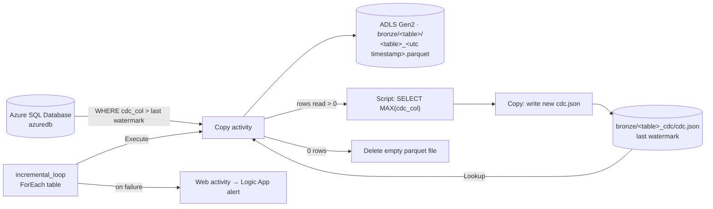

# Azure Data Factory — Incremental SQL → Data Lake Ingestion

A metadata-driven **Azure Data Factory (ADF)** project that incrementally copies tables from **Azure SQL Database**
into the **bronze** layer of **Azure Data Lake Storage Gen2** as Parquet, using a change-data-capture (CDC)
watermark stored per table. One generic pipeline handles any table; a wrapper pipeline loops over a list of tables
and sends an alert if the run fails.


## Architecture



## How the incremental load works

Pipeline **`incremental_ingestion`** (one table per run):

1. **`last_cdc`** (Lookup) reads the previous watermark from `bronze/<table>_cdc/cdc.json`.
2. **`current`** (Set variable) stores `utcNow()`; it is used to name the output file.
3. **`AzureSQLToLake`** (Copy) runs
   `SELECT * FROM <schema>.<table> WHERE <cdc_col> > <from_date, or the last watermark if from_date is empty>`
   and writes Parquet (snappy) to `bronze/<table>/<table>_<timestamp>`.
4. **`if_incremental_data`** (If): only when rows were read (`dataRead > 0`)
   - **`max_cdc`** (Script) gets `MAX(<cdc_col>)` from the source table.
   - **`update_last_cdc`** (Copy) writes that value back to `cdc.json` as the new watermark.
   - Otherwise **`DeleteEmptyFile`** removes the empty Parquet file so the lake isn't filled with zero-row files.

Pipeline **`incremental_loop`** runs the above for each entry in its `loop_input` array, one table at a time
(sequential ForEach). If the ForEach fails, the **`alerts`** Web activity posts the pipeline name and run ID to a
Logic App.

Tables configured by default:

| Schema | Table | CDC column |
|---|---|---|
| dbo | `DimUser` | `updated_at` |
| dbo | `DimTrack` | `updated_at` |
| dbo | `DimDate` | `date` |
| dbo | `DimArtist` | `updated_at` |
| dbo | `FactStream` | `stream_timestamp` |

**Pipeline parameters** (`incremental_ingestion`): `schema`, `table`, `cdc_col`, and an optional `from_date`
(set it to force a backfill from a specific value, leave empty for normal incremental runs).

## Repository layout

This is an ADF **Git-integration** repository, so the folder names are dictated by ADF and must not be renamed or
moved, or the factory will stop recognising its resources.

```
├── factory/            # factory definition (siddheshdfAzureProject, East US, system-assigned identity)
├── pipeline/           # incremental_ingestion, incremental_loop
├── dataset/            # azure_sql (table), parquet_dynamic, json_dynamic (parameterised ADLS locations)
├── linkedService/      # azure_sql (Azure SQL Database), datalake (ADLS Gen2)
├── publish_config.json # publish branch: adf_publish
└── README.md
```

## Resources used

| Type | Name |
|---|---|
| Data factory | `siddheshdfAzureProject` |
| Source | Azure SQL Database `azuredb` |
| Sink | ADLS Gen2 storage account, container `bronze` |
| Alerts | Azure Logic App (HTTP trigger) |

## Running it

1. In ADF Studio, connect the factory to this repo (collaboration branch `main`, publish branch `adf_publish`).
2. Recreate the credentials for the `azure_sql` and `datalake` linked services. Secrets are **not** stored in the repo.
3. Create the `bronze` container and make sure the source tables have the CDC column listed above.
4. Trigger `incremental_loop` (or `incremental_ingestion` with a single table's parameters) and check
   `bronze/<table>/` and `bronze/<table>_cdc/cdc.json`.

> **First run:** each table needs two small files in `bronze/<table>_cdc/`:
> `cdc.json` (read by the Lookup; seed it with `{"cdc": "1900-01-01"}`) and `empty.json` (a one-row JSON file such as
> `{}`; the `update_last_cdc` Copy reads it and adds the new `cdc` value as a column before writing `cdc.json`).
> Alternatively pass `from_date` for the first load, but `empty.json` is still required.

## Known limitations / next steps

- The alert only fires when the ForEach **fails**; there is no success notification or per-table error detail.
- `SELECT *` pulls every column. List columns explicitly for wider tables.
- The watermark is taken with `MAX(cdc_col)` from the source *after* the copy, so rows committed between the copy and
  the `MAX` query could be skipped. Capturing the maximum from the copied data (or using a small overlap window)
  avoids this.
- Silver/Gold transformations (e.g. Databricks or Fabric notebooks) are not part of this repo yet.
- Move the Logic App URL out of the pipeline JSON into a pipeline parameter or Key Vault secret.

*Last updated: November 2026*
